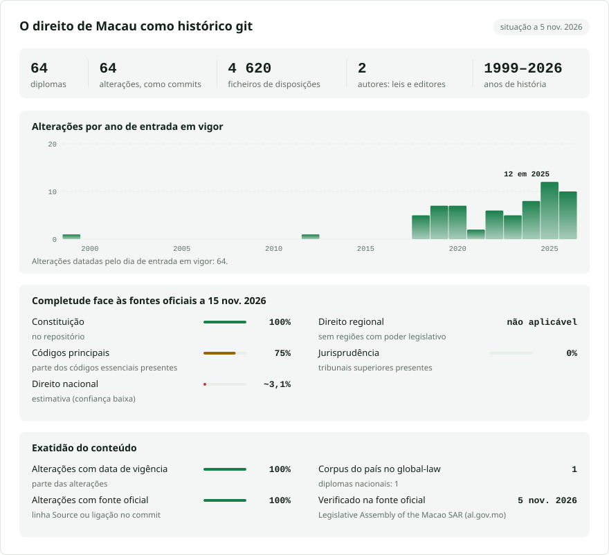

# Macau: a história do direito em git

**Português** · [English](README.en.md)

<picture>
<source media="(prefers-color-scheme: dark)" srcset="data/pt/effort-dark.svg">

</picture>

O direito de Macau como uma história git: um ficheiro por artigo (um ficheiro por lei para as leis recentes da Assembleia Legislativa), um commit por versão no dia indicado no seu trailer `In-force:` e, como autor do commit, o ato que fez cada alteração. Até agora, cada ato tem uma só versão, atribuída em vez disso ao seu editor: `git blame` e `git log` indicam de onde veio cada texto; escolhendo uma data, obtém-se o texto que o registo contém para esse dia.

Faz parte de [lexifina/global-law](https://github.com/lexifina/global-law), uma única história git do direito de todos os países: este é o direito nacional de Macau, que o global-law lê em `macau/national/acts/`.

**O que contém por agora:** 64 atos, cada um com uma só versão: a Lei Básica (preâmbulo e 145 artigos) e os seus três Anexos, em chinês; os Códigos Civil, Comercial, Penal e de Processo Penal e a Lei n.º 7/2008, a Lei das relações de trabalho, em textos atualizados em português; e 57 leis da Assembleia Legislativa de 2018 a 2026, cada uma tal como publicada pela primeira vez, em português. [`REPRODUCE.md`](REPRODUCE.md) lista todos os atos com a respetiva versão e o modo como cada uma foi escolhida.

Os códigos estão em `code/` (`code/codigo-civil/art-001.md` é o artigo 1.º do Código Civil), as leis da Assembleia em `lei/<year>/<number>/texto.md` (`lei/2024/6/texto.md` é a Lei n.º 6/2024, Lei sindical), a Lei das relações de trabalho em `lei-relacoes-trabalho/` (`art-046.md` é o artigo 46.º, Direito a férias), a Lei Básica em `basic-law/` e os seus Anexos em `annexes/`. [`data/paths.json`](data/paths.json) faz corresponder a cada identificador de ato a sua pasta.

O texto está nas duas línguas oficiais de Macau, tal como as fontes o publicam: chinês (tradicional) para a Lei Básica e os seus Anexos, português para o resto. Não faz parte deste registo nenhuma tradução inglesa.

## Perguntas como comandos git

| Pergunta | Comando |
| --- | --- |
| Todas as alterações ao artigo 46.º da Lei das relações de trabalho | `git log -p --word-diff -- lei-relacoes-trabalho/art-046.md` |
| A quem é atribuída cada linha do artigo 46.º? | `git blame lei-relacoes-trabalho/art-046.md` |
| Todas as versões da Lei das relações de trabalho, com o respetivo dia | `git log --format="%h %(trailers:key=In-force,valueonly,separator=) %an" -- lei-relacoes-trabalho ':!lei-relacoes-trabalho/README.md'` |
| O artigo 46.º tal como o registo o contém em 1 de janeiro de 2026 | `python tools/on.py 2026-01-01 lei-relacoes-trabalho art-046` |

**Fora do git**, também disponibilizamos este registo publicamente e de forma gratuita:

- **[Perguntar ao Claude sobre o direito de Macau](https://global-law.lexifina.com/v1/try_claude?country=macau)**: abre o Claude com uma primeira pergunta já preparada.
- **[Perguntar ao ChatGPT](https://global-law.lexifina.com/v1/try_chatgpt?country=macau)**: a mesma pergunta no ChatGPT.
- **[Pesquisar o direito de Macau no nosso sítio](https://lexifina.com/law?country=macau&q=f%C3%A9rias)**: uma pesquisa por "férias", com o texto de cada disposição e as suas versões, sem necessidade de conta.
- **[API REST para programadores](https://global-law.lexifina.com/v1/search_law?query=f%C3%A9rias&jurisdiction=macau)**: a mesma pesquisa em JSON, sem chave. Veja a [documentação aqui](https://lexifina.com/api/global-law).

Ambos os assistentes leem o registo através do conector gratuito Global law (MCP, `https://global-law.lexifina.com/mcp`); da primeira vez, a conversa dá-lhe a ligação que o adiciona. Pergunte em português, em chinês ou em inglês.

**Aloje-o facilmente por conta própria.** Basta ter git e Python, e as ferramentas correm na sua máquina:

```sh
git clone --depth 1 https://github.com/lexifina/global-law && cd global-law
python3 tools/countries.py add macau/national/acts
python3 tools/law.py show 2026-01-01 macau/national/acts/lei-relacoes-trabalho/art-046.md
```

Aberto no Claude Code, no Cursor, no VS Code ou no Codex, o clone inicia também um servidor MCP local com as mesmas ferramentas ([MCP.md](https://github.com/lexifina/global-law/blob/main/MCP.md)).

## Datas

Cada commit tem a data do meio-dia, hora de Asia/Macau (UTC+8), do dia indicado no seu trailer `In-force:`:

- a Lei Básica: 20 de dezembro de 1999, o dia em que começou a ser aplicada; os Anexos: 30 de junho de 2012, a data mais recente na página da Assembleia Legislativa, que mostra as alterações de 2012 ao lado do texto original;
- os quatro códigos e a Lei n.º 7/2008: o dia em que a página do Boletim Oficial mostrava o texto atualizado utilizado (de 13 de fevereiro a 17 de setembro de 2025). Não é o dia em que o texto começou a produzir efeitos, já que a página não indica nenhuma data de consolidação; a publicação original de cada ato consta do `REPRODUCE.md`;
- cada lei da Assembleia: o dia de entrada em vigor indicado na lista de leis da Assembleia ou, quando a lista não o indica, na norma de entrada em vigor da própria lei.

Cada commit é atribuído ao seu editor como "versão mais antiga disponível": `Legislative Assembly of the Macao SAR (al.gov.mo)` para a Lei Básica, os Anexos e as leis da Assembleia, `Imprensa Oficial da RAEM (Boletim Oficial)` para os códigos e a Lei n.º 7/2008. Nenhuma alteração é ainda atribuída à lei que a fez.

## Como é verificado

- `tools/check_repo.py` relê a partir do git cada versão no dia em que entrou em vigor e no dia anterior e compara-a com o corpus: 0 divergências (ver [`REPRODUCE.md`](REPRODUCE.md)).
- Uma lei da Assembleia só é incluída enquanto nenhuma lei posterior da Assembleia publicada até 5 de novembro de 2026 se referir a ela, pelo que o seu texto tal como publicado pela primeira vez é tomado como o seu texto atual; não se presumem alterações nem revogações, e as leis cujo texto ou anexos precisam de revisão ficam retidas.
- Os trailers de todos os commits são legíveis; não há commits de fusão (merge) no `main` nem nenhum commit com data posterior à construção. Ainda não foi comparada uma segunda construção.

## O que não mostra

- **Versões anteriores.** Cada ato tem um só texto; as notas de rodapé dos códigos que indicam as leis que os alteraram ficam de fora, e nenhuma alteração é atribuída a uma lei de alteração.
- **A maior parte do direito de Macau.** Nenhuma lei da Assembleia anterior a 2018 e apenas parte das posteriores, nenhum decreto-lei anterior a 1999 além dos quatro códigos, e nenhum regulamento administrativo.
- **Sete leis ainda não em vigor** (Lei n.º 4, 7, 8, 9, 10, 14 e 15/2026, que entram em vigor entre 1 de dezembro de 2026 e 1 de setembro de 2027): as suas pastas contêm apenas um README, sem o texto.
- **A outra língua oficial.** Os códigos e as leis estão aqui apenas em português, a Lei Básica apenas em chinês.
- **Jurisprudência.** Nenhuma decisão judicial faz parte deste registo.

## Fontes

| Fonte | Tipo | Versões anteriores | Notas |
| --- | --- | --- | --- |
| [Assembleia Legislativa da RAEM: Lei Básica](https://www.al.gov.mo/zh-hant/basic-law.html) | A Lei Básica e os seus Anexos, em chinês | não | Os Anexos com as alterações de 2012 ao lado do texto original |
| [Boletim Oficial](https://bo.io.gov.mo/) (Imprensa Oficial) | Textos atualizados dos quatro códigos e da Lei n.º 7/2008, em português | não, apenas o texto atualizado | As notas de rodapé do sítio que remetem para as leis de alteração ficam de fora |
| [Assembleia Legislativa da RAEM: leis](https://www.al.gov.mo/pt/law.html) | A lista das leis desde 1999, com o texto de cada lei no Boletim Oficial (I série) | não, o texto tal como publicado pela primeira vez | O texto em português; o dia de entrada em vigor, da lista |

## Licença

Veja [`LICENSE`](LICENSE). As fontes não indicam nenhuma licença: a Lei Básica (do sítio da Assembleia Legislativa) e os códigos e leis (do Boletim Oficial, publicado pela Imprensa Oficial) são textos jurídicos oficiais, reproduzidos para consulta com atribuição aos seus editores. A organização deste repositório, as mensagens de commit e as ferramentas são da Lexifina, sob a licença Creative Commons Atribuição 4.0 Internacional.

Nenhum modelo de IA escreveu, traduziu ou corrigiu texto jurídico, e nenhum é executado quando a história é construída; os scripts foram escritos por modelos de IA, Claude Opus 5.5 e GPT-6 (veja [`REPRODUCE.md`](REPRODUCE.md)).

Esta é uma tradução da versão inglesa ([README.en.md](README.en.md)); em caso de divergência, prevalece a versão inglesa.

## Mais informação

Do repositório [lexifina/global-law](https://github.com/lexifina/global-law) (páginas em inglês):

- [FEATURES.md](https://github.com/lexifina/global-law/blob/main/FEATURES.md): todas as funcionalidades e o que cada corpus tem de suportar (`git blame`, `law.py`, ferramentas MCP)
- [FAQ.md](https://github.com/lexifina/global-law/blob/main/FAQ.md): perguntas e respostas · [CONTRIBUTING.md](https://github.com/lexifina/global-law/blob/main/CONTRIBUTING.md): propor alterações · [MCP.md](https://github.com/lexifina/global-law/blob/main/MCP.md): servidor MCP · [REPRODUCE.md](https://github.com/lexifina/global-law/blob/main/REPRODUCE.md): como foi construído · [CHANGELOG.md](https://github.com/lexifina/global-law/blob/main/CHANGELOG.md)
- [FRESHNESS.md](https://github.com/lexifina/global-law/blob/main/FRESHNESS.md): quão atualizado está cada corpus · [Monitorização](https://github.com/lexifina/global-law/tree/main/monitoring): se as atualizações estão a funcionar · [WATCHING.md](https://github.com/lexifina/global-law/blob/main/WATCHING.md): como cada fonte oficial é vigiada para detetar alterações
- [performance/](https://github.com/lexifina/global-law/tree/main/performance): a rapidez das ferramentas, medida
- [visualisations/](https://github.com/lexifina/global-law/tree/main/visualisations): gráficos e ligações através do direito de todo o mundo
- [Vulnerabilidades](https://github.com/lexifina/global-law/tree/main/vulnerabilities): erros nos diplomas tal como foram publicados
